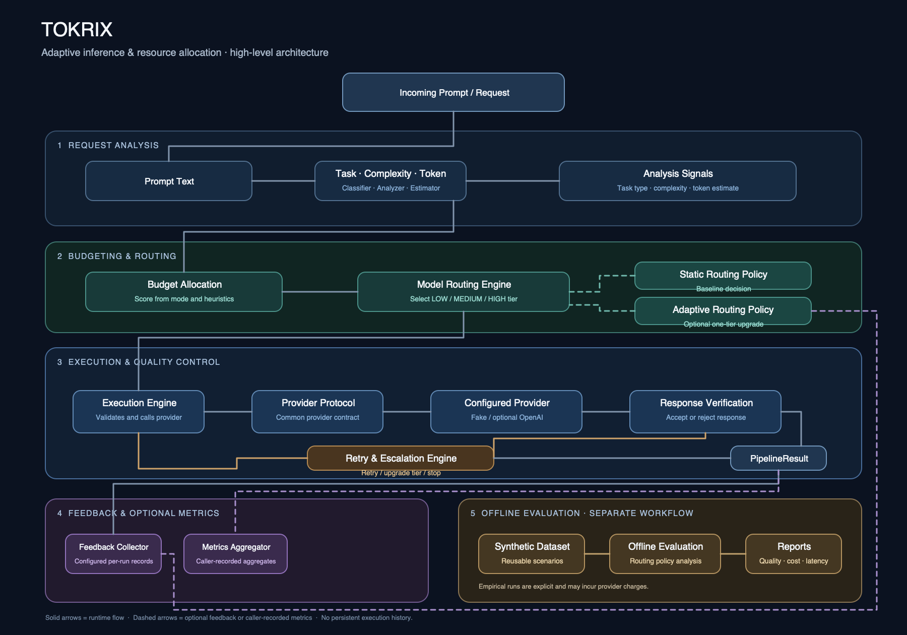

Tokrix
====

Tokrix is a Python library for adaptive inference and resource allocation. It
helps applications analyze prompts, choose an initial model tier, execute and
verify responses, and optionally use task-specific feedback to improve future
routing decisions.

Tokrix keeps its core standard-library-first and makes provider execution
explicit. It does not make model calls during import or ordinary routing and
synthetic evaluation.

Features
--------

- **Prompt analysis:** heuristic task classification, complexity scoring, and
  approximate token estimation.
- **Resource allocation:** deterministic budget scoring and LOW/MEDIUM/HIGH
  routing.
- **Execution workflow:** provider abstraction, verification, retry and
  escalation, and in-memory telemetry.
- **Adaptive routing:** optional, configurable upgrades informed by completed
  task-specific feedback; static routing remains the fallback.
- **Evaluation:** deterministic offline routing/performance datasets and a
  separate, explicitly invoked empirical provider benchmark.

Installation
------------

Tokrix requires Python 3.11 or newer and has no mandatory runtime dependencies.
From a repository checkout, install the package with:

```bash
python3 -m pip install .
```

For development, including tests and linting:

```bash
python3 -m pip install -e ".[dev]"
```

The OpenAI provider is optional. Install it only when you intend to use that
provider:

```bash
python3 -m pip install ".[openai]"
```

Quickstart and architecture
---------------------------

The pipeline accepts provider implementations through the existing
`ModelProvider` interface. It analyzes and classifies a prompt, estimates its
size, selects a budget and starting tier, executes through a provider, verifies
the response, and may retry or escalate according to the result. When enabled
and supplied with a `FeedbackCollector`, adaptive routing uses prior
task-specific outcomes to choose at most a one-tier upgrade before execution.
Completed runs can then contribute feedback for later requests.

The following example makes a real provider call. It requires an OpenAI API key
and may incur charges; importing the provider or constructing a pipeline does
not itself make a request. See `examples/basic_pipeline.py` for the complete
example:

```bash
python3 -m pip install ".[openai]"
export OPENAI_API_KEY="your-api-key"
python3 examples/basic_pipeline.py
```

For deterministic prompt analysis and routing without a provider, the
intelligence APIs are available from `tokrix.intelligence`:

```python
from tokrix.budget import BudgetMode, allocate_budget
from tokrix.intelligence import analyze_complexity, classify_task, estimate_tokens
from tokrix.routing import route_model

prompt = "Implement a Python function that validates a cache key."
task = classify_task(prompt)
complexity = analyze_complexity(prompt)
budget = allocate_budget(
    complexity.score,
    task.task_type,
    estimate_tokens(prompt),
    mode=BudgetMode.BALANCED,
)
decision = route_model(budget)
print(decision.tier, decision.reason)
```

The classifier, complexity score, and token estimate are deterministic
heuristics, not calibrated measures of task difficulty, compute requirements,
or tokenizer output.

Architecture
------------



The pipeline analyzes a prompt, allocates a budget, selects a static baseline
tier, and can apply an optional feedback-informed recommendation before
execution. Each execution is verified; failed responses can be retried or
escalated. A configured feedback collector records completed runs for future
task-specific recommendations. Applications may separately pass a
`PipelineResult` to `MetricsAggregator`; it aggregates metrics in memory and
does not persist execution history.

Offline synthetic evaluation is a separate workflow from empirical provider
benchmarking. The former uses controlled scenario assumptions; the latter
executes only when explicitly invoked with configured providers and may incur
provider charges.

Contributors can inspect or edit the
[Mermaid source](docs/architecture/tokrix_architecture.mmd) or
[SVG diagram](docs/assets/tokrix_architecture.svg).

OpenAI-backed pipeline example
------------------------------

`examples/basic_pipeline.py` configures one OpenAI provider for each model
tier. The quickstart above includes the install and run commands. The model
names are constants in the example and can be changed to models available to
your OpenAI account. Running it sends the prompt to a provider and may incur
API charges.

Feedback-driven adaptive routing
--------------------------------

Adaptive routing uses historical, task-specific verification outcomes when a
`FeedbackCollector` is configured. Its default policy requires at least five
samples per tier, limits the current tier's success rate to 60%, requires a
higher-tier success rate of at least 80%, and requires at least a 20 percentage
point improvement. Recommendations only upgrade by one tier; LOW and MEDIUM may
upgrade, HIGH cannot, and routing never downgrades. Without a feedback
collector, the pipeline uses static routing.

The immutable `AdaptiveRoutingPolicy` exposes those thresholds. Pass it as
`adaptive_policy`. Adaptive routing is enabled by default when a collector is
present; set `adaptive_routing_enabled=False` to retain static tier selection
while still collecting completed-run feedback:

```python
from fractions import Fraction

from tokrix.feedback import FeedbackCollector
from tokrix.pipeline import TokrixPipeline
from tokrix.routing import AdaptiveRoutingPolicy

feedback = FeedbackCollector()
policy = AdaptiveRoutingPolicy(
    minimum_samples_per_tier=8,
    max_current_success_rate=Fraction(1, 2),
    min_higher_success_rate=Fraction(9, 10),
    min_success_rate_improvement=Fraction(3, 10),
)
pipeline = TokrixPipeline(
    providers,
    feedback_collector=feedback,
    adaptive_policy=policy,
)
result = pipeline.run("Explain photosynthesis.")

print(result.routing_decision.tier)  # Original budget-based tier
print(result.recommended_tier)  # Adaptive recommendation
print(result.selected_tier)  # Tier actually used after any escalation
print(result.adaptive_routing_explanation.reason_code)
print(result.adaptive_routing_explanation.tier_sample_counts)
print(result.adaptive_routing_explanation.tier_success_rates)
```

`adaptive_routing_explanation` is an immutable snapshot with the original and
recommended tiers, task type, policy, evidence availability, per-tier sample
counts and success rates, upgrade outcome, stable reason code, and readable
reason. Its reason code distinguishes an approved upgrade, a sufficiently
successful current tier, insufficient evidence, unmet higher-tier thresholds,
no eligible higher tier, disabled adaptive routing, and an unavailable feedback
collector. It reflects only feedback available before the run began.

To disable adaptive recommendations while keeping feedback collection:

```python
pipeline = TokrixPipeline(
    providers,
    feedback_collector=feedback,
    adaptive_routing_enabled=False,
)
```

The pipeline snapshots existing feedback before routing, then records the
completed run's per-attempt feedback afterward. A request therefore cannot use
its own outcome to choose its initial tier. With adaptive routing disabled, the
original static routing tier is used and no recommendation is computed, but an
available collector still records the run. Insufficient task-specific evidence
retains the static tier. The collector stores feedback only in memory.

Offline end-to-end demonstration
-------------------------------

`examples/full_pipeline_demo.py` shows prompt analysis, token estimation,
budgeting, static and adaptive routing, provider execution, verification,
retry and escalation, feedback collection, routing explanations, and telemetry
in one offline run. Its deterministic fake LOW-tier provider returns an empty
response, so verification triggers a same-tier retry and then escalation to
MEDIUM. Five completed runs build task-specific feedback before a later run
demonstrates the adaptive upgrade. It needs no credentials, optional provider
package, network access, or paid API calls:

```bash
python3 examples/full_pipeline_demo.py
```

Offline routing benchmarks
--------------------------

The offline routing benchmark compares static routing with Tokrix's adaptive
routing policy using a deterministic, built-in catalog of 29 immutable
scenarios, covering all seven task types. Each scenario includes a workload
group, a 1–5 difficulty level, qualitative resource demand, a representative
prompt, historical feedback for routing, and expected verification outcomes
for LOW, MEDIUM, and HIGH tiers. The catalog spans factual, reasoning, coding
and debugging, long-document summarization, ambiguous, multi-constraint,
resource-constrained, structured-data, and creative workloads.

Expected outcomes are controlled synthetic assumptions designed to include
cases where LOW is enough, MEDIUM or HIGH improves results, higher tiers add
little, or a higher tier performs worse. They are not measurements of real
provider or model performance. The benchmark uses these outcomes to score
selected tiers, and uses historical synthetic feedback separately for adaptive
recommendations. It does not execute models, make provider calls, or require
API keys.

From the repository root, install Tokrix in editable mode and run the example:

```bash
python3 -m pip install -e .
python3 examples/routing_benchmark.py
```

The report includes verification success rates for static and adaptive routing,
their difference in percentage points, average tier-cost proxies, relative cost
change, and changes in LOW/MEDIUM/HIGH tier counts. It also counts cases where
adaptive verification improved, degraded, or stayed unchanged compared with
static routing; the outcome percentages use all evaluated cases as their
denominator.

All reported differences are adaptive minus static. A positive success-rate
difference means adaptive routing succeeded more often; a negative one means it
succeeded less often. A positive cost difference means a higher relative tier
cost, while a negative one means a lower relative tier cost. The tier-cost
proxy assigns LOW/MEDIUM/HIGH the relative values 1/2/3; it is not provider
pricing, token usage, or a monetary estimate.

The expected outcomes are synthetic benchmark data, not measurements from real
models. Treat the results as a reproducible demonstration of the evaluation
workflow, not as evidence or a prediction of real-world model performance.

### Quality, cost, and latency assumptions

The companion performance dataset assigns each scenario a synthetic quality
score and normalized cost/latency profile for every tier. The profiles are
deterministic assumptions derived from the scenario's modeled verification
outcomes, complexity, and resource demand; they are not empirical measurements
of real models or providers. Evaluate aggregate and per-scenario trade-offs
offline:

```python
from tokrix.routing import (
    evaluate_routing_performance,
    get_performance_benchmark_dataset,
)

result = evaluate_routing_performance(get_performance_benchmark_dataset())
print(result.static_metrics.average_quality_score)
print(result.adaptive_metrics.average_cost_units)
print(result.adaptive_metrics.average_latency_ms)
print(result.case_results[0])  # Per-scenario selected tiers and profiles
```

Run the complete report with:

```bash
python3 examples/routing_performance_benchmark.py
```

Higher quality may come with greater modeled cost or latency, while scenarios
where LOW already meets the expected outcome can show no modeled quality gain
from higher tiers. Cost units are normalized within this synthetic dataset,
not provider prices. Provider benchmarking is outside this offline example.

### Empirical provider benchmarking (opt-in)

M25's evaluation is synthetic and offline; M26's empirical benchmark explicitly
executes prompts through configured providers. It makes no calls during import,
configuration construction, or ordinary tests. Calling
`run_empirical_benchmark(config)` is the point that performs provider
executions. Running the example requires the optional OpenAI SDK and credentials
and may incur API charges:

```bash
python3 -m pip install -e ".[openai]"
export OPENAI_API_KEY="your-api-key"
python3 examples/empirical_provider_benchmark.py
```

Configure explicit targets, cases, repetitions, and optionally a quality
evaluator or model-specific `TokenPricing`. Latency is measured around each
execution; token counts are collected only when a response exposes them.
Provider-reported cost is kept separate from estimates computed using supplied
input/output prices. If neither source is available, cost remains `None`.
Quality is `None` unless a caller supplies a scoring evaluator; latency, token
usage, and execution success alone do not measure answer quality. Aggregates
include available/total measurement counts so partial data is visible, and
individual runs retain failure and evaluation-error details.

An evaluator receives the benchmark case and provider response and must return
a finite quality score from 0 to 100. Its rubric remains the caller's
responsibility; Tokrix does not infer quality from response length or successful
execution.

Examples
--------

| Example | What it demonstrates | External calls / credentials |
| --- | --- | --- |
| `examples/basic_pipeline.py` | End-to-end pipeline using configured OpenAI models | Yes; OpenAI SDK and API key; may incur charges |
| `examples/full_pipeline_demo.py` | Complete offline pipeline, retry/escalation, feedback, adaptive routing, and telemetry | No; deterministic fake providers |
| `examples/routing_benchmark.py` | Synthetic static/adaptive routing comparison | No; deterministic and offline |
| `examples/routing_performance_benchmark.py` | Synthetic quality, normalized cost, and latency comparison | No; deterministic and offline |
| `examples/empirical_provider_benchmark.py` | Explicit repeated measurements through OpenAI | Yes; OpenAI SDK and API key; may incur charges |

Run either offline example from the repository root with
`python3 examples/<name>.py`. The provider-backed examples are ordinary
scripts: review their configuration before running them. Importing them does
not execute `main()` or send a request.

Limitations
-----------

- Task classification, complexity, and token counts use simple heuristics;
  they are not calibrated predictors.
- Adaptive routing is driven by in-memory feedback and only learns from
  completed, task-specific outcomes available to the process.
- Offline evaluation uses synthetic assumptions and must not be interpreted
  as real provider quality, latency, or monetary cost.
- Empirical latency and token usage depend on the configured provider and
  environment. Provider-reported costs may be absent, and estimates require
  pricing explicitly supplied by the caller.
- Quality scores require a caller-provided evaluator and rubric; Tokrix does
  not guarantee the quality or factual correctness of generated responses.

License
-------

Tokrix is licensed under the MIT License. See the root-level `LICENSE` file
for the complete license text.
